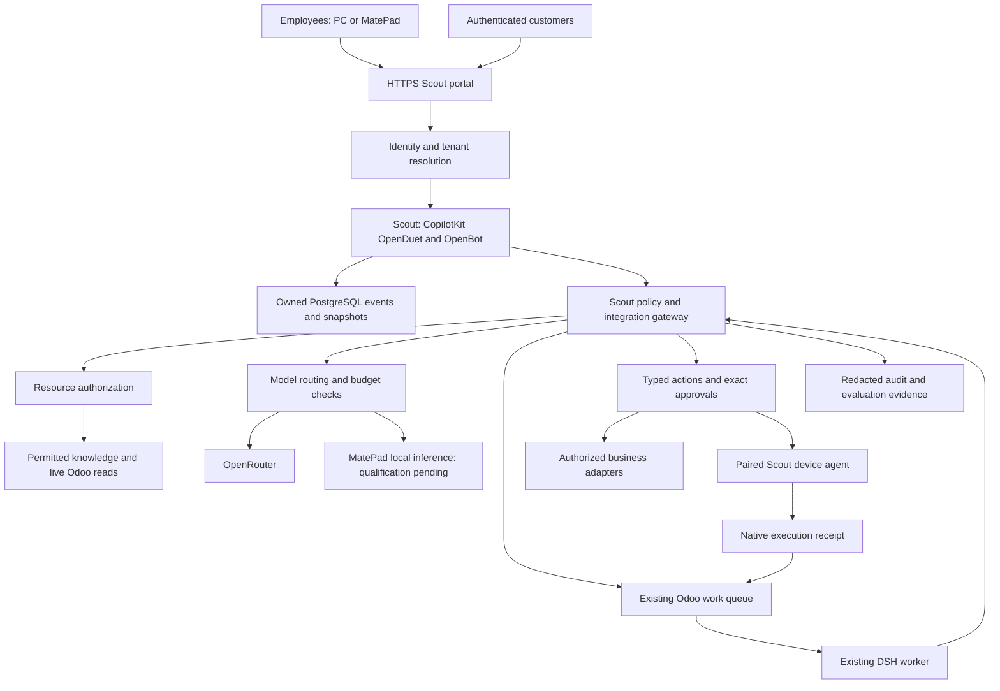

# Scout: owned AI for employees and customers

Updated: 2026-11-03, Asia/Shanghai. Status: architecture and implementation contract,
not a claim of deployed enterprise controls. Primary engineering tracker:
[SSC AI Enablement #4](https://github.com/Nepritariel08/ssc-ai-enablement/issues/4#issuecomment-6547459663),
under architecture #8. The active interface source is the owned
[CopilotKit OpenDuet fork](https://github.com/Nepritariel08/scout-copilot).
The earlier [scout-workspace architecture](https://github.com/Nepritariel08/scout-workspace/blob/scout/bootstrap-20261101/docs/SCOUT-ENTERPRISE-ARCHITECTURE.md) is retained as the source reference. This file updates its persistence and lean deployment decisions; it does not repeat repository selection.

## Outcome and decisions

Operate one branded Scout product: employees and customers ask questions, see
only permitted context, and request authorized work. The owner controls code,
identity policy, connectors, knowledge, model routes, spending and recovery.
Using OpenRouter does not mean we own its model weights or that inference is
local. Model training is not required for the initial system; permission-aware
retrieval supplies current business knowledge.

The reference [Instagram reel](https://www.instagram.com/reel/DfCi2s4zNno/)
describes surrounding layers for instructions, retrieval, tools, permissions,
safeguards, caching, routing and monitoring. Its caption and initial visual
explanation were inspected in the authenticated owner browser; no complete
audio transcript was obtained. It guides the architecture, not authority.

1. **One user-facing Scout workspace.** The owner's latest direction selects
   **CopilotKit/OpenDuet**, built on OpenBot, as Scout's interface foundation.
   Use its tenant-package extension and AG-UI integration boundaries. Its MIT
   source does not establish enterprise isolation. Explicit Scout owned mode now uses
   the public MIT runner and our PostgreSQL persistence adapter; the optional
   licensed Intelligence composition remains available under its own entitlement. The prior LibreChat recommendation is superseded;
   its test evidence does not transfer to CopilotKit. See the
   [pivot contract](https://github.com/Nepritariel08/scout-workspace/blob/scout/bootstrap-20261101/docs/SCOUT-COPILOTKIT-PIVOT.md).
2. **Keep the useful work already done.** Retain the Anil-matcha pilot's submission,
   review and crash-recovery contracts, the existing Odoo queue/DSH worker and
   Scout's native MatePad approval/execution boundary. Port capabilities behind
   stable interfaces; do not combine entire dependency trees or run three
   competing production chat apps. Retire an old interface only after parity
   tests and export/recovery checks pass.
3. **Use the existing Community Linode for a bounded pilot.** Isolate service
   accounts, data stores, ports and resource budgets. Proximity to Odoo does
   not grant database rights. Customer production capacity and availability
   remain separate acceptance: one host is one failure domain. Keep the current
   8 GB / 4 vCPU instance; resize only for measured capacity or recovery needs.
4. **Authorization is enforced by services.** Prompts, model answers, retrieved
   documents and client-supplied tenant headers cannot grant permission.
5. **Current live runtime stays owner-private and draft-only.** Fixed requester
   UID5 is not an employee/customer identity system. Do not open staff/customer
   registration against that binding or imply that existing company isolation
   already proves customer isolation. This historical pilot is separate from
   deployment of the owned CopilotKit source described below.

## Core product qualification comes first

The owner's 2026-11-03 correction prioritizes a working integrated OpenDuet/Scout
workspace before additional features. Preserve the useful interface and working
components, connect them to the existing Odoo Community infrastructure, and test
complete workflows. A navigation item or a source test is not a working feature.
Computers and Connections showing failed reads are open integration defects.
An accurate capability catalog is necessary, but does not complete those adapters.
The primary Work Item and engineering issue above remain the outcome tracker.

The intended product combines individual authenticated accounts, permitted Odoo
and external knowledge, research, reviewed actions, persistent work context and
event-driven assistance. Owner-private acceptance comes before staff/customer
rollout. Retain both work-app/Odoo and browser/computer workflows; continuous
hands-free voice is required, with review-before-Send push-to-talk as fallback.

### Reuse and infrastructure decisions

- Keep the CopilotKit/OpenDuet conversation, navigation, task/review and visual
  components. Adapt their data ports for owned mode rather than building another
  chat application or presenting unavailable vendor services as configured.
- Odoo remains authoritative for business records, assignments, commitments,
  deadlines, activities, timesheets and business permissions. Existing Odoo/DSH
  work-item identities, durable intents and receipts remain authoritative for
  delegated execution. No duplicate business tracker or scheduler is introduced.
- Use the existing Community Linode and PostgreSQL infrastructure. The current
  dedicated owned-conversation database remains intact. Putting Scout into the
  Odoo workspace does not require unreviewed writes to Odoo's SQL tables or moving
  working chat history. If native Odoo conversation models are later selected,
  qualify a persistence adapter, migration, export and restore before replacement.
- Provide an Odoo application entry point and a shared workspace experience.
  Native Odoo business actions use the mapped user's ORM/API permissions. Preserve
  the current authenticated Scout URL and callbacks during integration; embedding
  or changing origins must qualify its session and browser trust boundaries.
- External sources remain connected through source-specific adapters. Microsoft
  sign-in alone grants no Outlook/Teams/SharePoint data access; installed ChatGPT
  plugins do not transfer tokens, consent or tool availability into Scout.
- A computer is an execution runtime, not a database feature. An isolated browser
  worker, an owner desktop companion for selected folders, and a paired MatePad
  are distinct providers behind one Computers interface. Never use the Community
  host's unrestricted shell or Docker socket as an assistant tool.
- Reuse public MIT computer gateway/policy and plugin code where compatible with
  native identity, tenancy and approval. Preserve licensed Intelligence contracts;
  no entitlement emulation is part of the owned replacement.

### Minimum observable acceptance

| Core surface | Required integrated behavior | Evidence before calling it usable |
| --- | --- | --- |
| Sign-in and conversations | Owner signs in, sends a bounded real model request, reopens saved history and stops a turn | Actual HTTPS response, saved/reopened messages and cancellation receipt; no false-success UI |
| Odoo context | A mapped user selects permitted records; current context and business actions respect Odoo rights | Exact source match plus denial after rights or credential revocation |
| Connections | Show actual per-user connection state and a working setup/revoke flow for each admitted source | A real authorized source read, another-user denial, revoke/readback and visible expired/unconfigured state |
| Computers | List the configured provider and run one approved bounded browser/device workflow from Scout | Owner request, exact approval when required, execution, result/readback, cancellation and duplicate prevention |
| Desktop folders | The real companion grants a selected folder for the current session and asks before edits/commands | Actual companion connection, granted-folder read and out-of-scope denial; a server browser is not folder access |
| Skills and tools | Installed instructions describe tools that really exist and carry the user's current grants | Discover, invoke, audit and revoke one real supported tool; no prompt-granted authority |
| Voice | Start, speak, receive one saved answer aloud, return to listening and Stop | Actual owner microphone/browser test without echo or a model request after Stop; fallback remains usable |
| Delegated work | Existing DSH handles a reviewed request and exact-revision draft acceptance once | Durable source/idempotency identity, lease/result/acceptance receipts and no ambiguous retry |
| Proactive assistance | Relevant events produce priorities or a reviewed end-of-day/timesheet draft | A real scoped trigger and traceable source-linked outcome; planned reminders are not live acceptance |

Clock-in priorities and clock-out journaling/timesheet assistance should use
existing Odoo events and work records. A later rollout must validate record
accuracy, employee access and recovery; it must not silently turn a reminder
into a new restriction on sign-out or an automatically accepted timesheet.

The first computer acceptance is a non-business public navigation/readback task,
followed by a permissioned real workflow. The first useful connection is the
already scoped Odoo path; adding other work apps requires their actual delegated
authorization and owned tool/result adapters. Fixing error text alone does not
satisfy either acceptance. Record source, CI, staged, live and human-accepted
states separately in the existing primary tracker.

## Product and trust boundaries

The diagram is the target design. The current DSH worker has no tool access;
the DSH-to-gateway and action edges are future, separately qualified additions.
Ordinary chat runs through one model path. Delegated work runs through DSH once;
the UI must not also execute the same request through its own background agent.
Existing AI Forge feature queues retain their accepted scope until a specific
workflow is intentionally migrated with a stable originating-message key.

| Data or responsibility | Authority |
| --- | --- |
| Identity, membership, account revocation | Selected identity provider and verified Scout membership mapping |
| Business records and their source permissions | Owning Odoo database or authorized upstream service |
| Work state, worker lease, result, human acceptance | Existing Odoo Community work queue |
| Conversation threads | Scout owned PostgreSQL events/snapshots through the public MIT runner, native owner/tenant grants and durable admission; optional licensed Intelligence keeps its separate default composition |
| Attachments, policies, approvals and local application state | Scoped OpenBot PostgreSQL/pgvector and protected object/file storage; qualify exact ownership and backup coverage |
| Document access relationships and Scout resource policy | Scout authorization store, intersected with source rights |
| Physical device execution and local readback | Paired native Scout agent; report provenance retained |
| Engineering source, policies, skill versions, tests | GitHub review and versioned release manifests |

## The eight surrounding layers

| Layer | Implementation contract | Required evidence |
| --- | --- | --- |
| Instructions and skills | Versioned approved instructions; workflow/skill allowlist; retrieved content treated as data. No prompt can impersonate an administrator. | Template/skill version in every trace; injected instructions cannot change tool grants. |
| Retrieval and context | Check tenant and source permissions before selecting chunks or records; attach provenance and freshness; bound context size. | Customer A cannot retrieve B's documents, names, snippets, citations or inferred search results. |
| Tools and execution | Typed, narrowly scoped adapters; per-call authorization and current-record checks; DSH for durable delegated work. | One work-item ID and execution attempt; unauthorized tools never become available to the model. |
| Access control | Verified identity plus tenant membership, role, customer/project relationships and source ACLs; deny missing context. | Cross-user/tenant/company/project negative tests, including customers in the same Odoo company. |
| Safeguards and review | Upload/parser limits, injection resistance, data-release policy, output checks and risk-based exact-action approval. | Malicious documents cannot trigger sends, credential disclosure or permission changes. |
| Cache and memory | Scope private caches/memory to tenant and authorized principals; bind to policy/source versions. Public cache only for deliberately public content. | Revoked access and another customer's semantically identical question cannot recover private cached content. |
| Model routing and budgets | Approved providers/models by data class; output/context caps; per-user/tenant budgets and concurrency; explicit fallback policy. | Real usage/cost where available; unknown cost remains unknown; budget exhaustion and provider outage fail safely. |
| Observability and evaluation | Trace IDs linking identity/policy, sources, model/cost, work item, approval and result; redact sensitive content. Versioned regression evaluations before promotion. | Auditable allowed/denied actions, restart/restore evidence, security regression results and rollback. |

## Identity, staff and customer isolation

Use the existing company identity provider for staff OIDC where it is available
and approved. Keycloak is an alternative or broker for an owned customer
identity service; do not deploy it alongside another provider merely to add a
component. Invite the first staff cohort; disable open registration. Customer
identity, organization membership and recovery are provisioned through a trusted
administrative flow. MFA and session revocation are required for administrators
and privileged operations.

The gateway derives a principal from a verified session/token: issuer, audience,
subject, active tenant, actor type, authenticated membership, permitted company
and project/customer bindings, authentication time, policy version and trace ID.
Clients can select among verified memberships; they cannot establish membership
by submitting `tenant_id`, `user_id`, a role or an Odoo UID. Strip untrusted
identity headers at ingress, and validate audience/expiry again at tool servers.

Roles define allowed capabilities. Resource relationships define the actual
records/documents/devices those capabilities apply to.

Provision each tenant's versioned capability policy before admitting its users;
reject admission if the tenant lacks an approved policy. Qualify policy updates
and revocation with cache invalidation and API readback. The historical LibreChat
runtime check found that disabling a capability in YAML updated platform roles
while a new tenant could receive permissive default roles. Explicit tenant-role
provisioning made the tested API denials pass; see the
[qualification evidence](https://github.com/Nepritariel08/scout-workspace/blob/scout/bootstrap-20261101/docs/SCOUT-LIBRECHAT-QUALIFICATION.md). A hidden menu does
not establish server-side denial. That finding motivates this platform-neutral
requirement; it is not a claim about CopilotKit. CopilotKit channel groups,
single-user mode, skills and model prompts must be tested against the same
server-side access matrix. Do not expose the upstream single-user administrator
default or copied personal-assistant package to employees/customers.

Proposed initial policy:

| Actor | Context and actions |
| --- | --- |
| Owner/platform operator | Configure the service under audited administration. Infrastructure access is privileged; do not describe all customer content as inaccessible to a host administrator. |
| Employee | Their own conversations, approved shared knowledge and source records allowed by their real company/project role. No default HR, finance, customer-wide or all-device access. |
| Manager/reviewer | Employee access plus explicitly assigned teams/projects and approval classes. A manager role alone does not expose every customer. |
| Customer | Their organization's permitted support/project/order records, approved documents and own conversations. No internal employee notes or another customer's records. |
| Anonymous visitor, if enabled later | Curated public FAQs only; account-specific questions require authentication. |
| DSH/service worker | Execution capability for the admitted work item, bounded tenant/principal context and allowlisted adapters; no reusable owner credential exposed to the model. |

### Implemented native scope and remaining boundaries

The owned source now derives deployment/tenant/user scope from the protected
current binding. Immutable `scout_resource_scopes` rows authorize native agents,
channels and pages only when their existing native visibility, owner or membership
rules also permit access. These are SQL predicates before reads, pagination and
writes. Channel attachments retain channel scope plus native uploader/sent-file
rules for uploads, model reads, GET/HEAD/conditional delivery and withdrawal.
Creation stamps ownership in the resource transaction; unscoped legacy records
are denied, with no automatic adoption by a user or a newly mapped tenant.
Curated package agents can be read as templates; a template grant cannot edit
their configuration or expose another tenant's channels. Native membership locks
and current-binding rechecks protect dependent writes and queue publication.
Websocket delivery rechecks the authenticated opening session and channel access.

Standing instructions are partitioned by deployment, tenant and native subject,
without a fallback to the old global-user row. Reassigning a subject does not
transfer old conversations, instructions, pages or channels to the new tenant.
The model policy separately controls whether personal instructions enter context.

`SCOUT_PLATFORM_OWNER_IDS` names exact verified native subject IDs. An empty
list grants no platform administrator; a listed user must also hold the native
admin role and current protected membership. Other native admins become ordinary
users in the owned composition. Platform ownership administers deployment-wide
people, credentials, audit and identity settings; it is not a customer/tenant
administrator role. All seven native SSO management endpoints are covered,
including provider listing/detail and domain verification, as documented in
[owned runtime configuration](OWNED-RUNTIME.md#platform-ownership-and-identity-administration).
Unadapted auth-admin and SCIM endpoints are unavailable. Bearer-only remote
callbacks, remote-agent execution and connection probes are not qualified
service identities. Do not activate them through global operator credentials.

These source adaptations have synthetic native SQL/SDK tests. They do not prove
company SSO, complete app-wide multi-tenancy, live Odoo record permissions,
shared-channel history, retrieval, tool execution, tenant administration or
employee/customer acceptance. Keep shared access closed until its full matrix
is verified. The unchanged default licensed composition has its own contract.

Tenant identity is not equivalent to `allowed_company_ids`. Multiple customers
can be company1. Source reads must also enforce customer/partner/project/record
rights. An unavailable source authorization check denies private retrieval or
execution; it must not fall back to an administrator query.

Start the customer pilot in a separate deployment/data namespace using the same
Scout application build, with no connection to internal-only collections. This
is one maintained product with isolated security zones. Consolidating runtime
instances requires explicit tenant-boundary tests across every store and route;
a single tenancy flag or UI group is insufficient. Customer production may
need a separate host for stronger isolation and availability.

## Permission-aware knowledge and memory

1. Register each source and its authorized identity/scope. Source connectors do
   not inherit ChatGPT plugins or device permissions.
2. Ingest only an approved corpus. Record source IDs, source ACLs, tenant,
   classification, owner, version, update/deletion time and citations. Parse
   untrusted uploads outside the model/tool execution environment, with bounded
   size and time. Embedding generation follows the same data-release policy.
3. Resolve allowed document/record IDs from current membership and source
   policy. Apply tenant/resource filters before retrieval/reranking; recheck
   selected sources before exposing text, summaries, citation labels or files.
4. Build the smallest useful context pack. Prefer live Odoo queries for current
   business facts; use retrieval for approved reference documents. If evidence
   is insufficient or stale, ask or report that limitation.
5. Revoke/delete access in indexes, attachments, exports, saved summaries,
   conversational memory and caches. Old conversations and downloaded copies
   need an explicit retention/access policy; deleting a vector alone is not
   complete revocation.

An Odoo adapter should execute within the correctly mapped nonadministrator
principal's record rules, or through a narrowly scoped server method that
verifies trusted delegation and the exact allowed domain/fields. The model
cannot choose a database, UID, arbitrary ORM method or `sudo`. OpenFGA can
express Scout document/project/device relationships; it cannot override Odoo's
own authoritative record restrictions. Effective access is their intersection.

For private response/retrieval caches include tenant, authorized principal or
sharing scope, policy/ACL version, source version, instructions version, model
route and relevant inputs. Reauthorize before returning a hit. Disable shared
semantic caching initially. Keep user memory private unless sharing is explicit.
Do not automatically turn customer chats into shared knowledge or training data.

## Actions, approvals and native MatePad capabilities

Retain the existing durable submission intent, stable request key, Odoo item
ID/revision, attempt count and DSH session linkage. Add verified initiating
principal, tenant, workflow/policy version, permitted resources, expiry and
approval references before expanding beyond the owner pilot. These fields come
from authenticated server admission, never from generated model text.

Reads, drafting, business mutations and device control are different action
classes. The gateway checks the requested action and current resource rights.
For a consequential mutation, show its exact target and payload, bind approval
to the payload digest/revision/expiry, recheck rights immediately before action,
execute once and retain authoritative readback. A changed payload or expired
approval requires fresh review. Accepting a draft does not authorize executing
its proposed business actions.

The current read-only inventory identifies the MateX6 registration; the second
Android registration's physical MatePad mapping and prior metadata-command
completion remain unverified. The earlier architecture reported Huawei PCE-W29,
Android12/HarmonyOS4 without a linked device receipt; that historical report does
not establish the current registration or its capabilities. See the
[device evidence boundary](PRIVATE-PILOT-DEPLOYMENT.md#device-boundary-retained).
Retain the native Scout approval/transport/readback source, but qualify the exact
source, installed signer/version and runtime parity before importing it. A
separately reported0.6.0 candidate is not an accepted installation or live capability.

Preserve this native adapter as a module of Scout. The shared web workspace is
the primary conversation/review surface. Do not expose a JavaScript bridge to
arbitrary remote pages, copy device credentials into a browser, enable remote
trust implicitly, or install a second local model/executor for the same task.
Only paired devices and declared capabilities may receive typed commands.
Device reports retain their provenance; an authenticated software report is not
hardware attestation. Physical UI actions require the tablet to be available
and any required accessibility/approval state to be satisfied.

## Model access, costs and outbound data

The default pilot may use the already approved OpenRouter route with bounded
synthetic input. Each workflow declares data classification and eligible
destinations. Sensitive data does not silently fall back from a private model
to a public provider. If no eligible route exists, stop or request the missing
authorization. A model on the Windows PC cannot provide PC-off availability.

Keep provider keys server-side and separate from worker/tool credentials.
Authorize every request before inference. Enforce maximum input/output tokens,
per-request unit-price limits, per-user/tenant daily/monthly quotas, request-rate
and concurrent-job limits, and account/provider credit controls where available.
Existing free-only unit-price checks do not constitute a total spending budget
or a production service guarantee. Cancelled requests may lack a final cost.

Prefer OpenRouter/native compatible routing initially. LiteLLM is an optional
later gateway if measured routing/budget requirements justify another service;
do not add a duplicate gateway by default. MatePad is the proposed always-on local-model and narrow executor node.
Its model, callable endpoint, quality, latency, thermal behavior, screen-off,
reboot and connectivity recovery need actual-device acceptance. A tablet AI app
alone does not prove on-device inference. The existing8GB Linode coordinates
identity, history and durable work; it is not intended to load model weights. Choose model quality and availability through task
evaluations, rather than fixing an architecture to today's model name.

## Same-Linode deployment and recovery

Use one HTTPS Scout entry point and central conversation store. Preserve the
current Odoo Home Menu, AI Forge, queue, DSH and private connector. The active
Community host owner must release WI75 before a fresh bounded deployment claim.
No host mutation is implied by publishing this design.

The first deployment is an invited owner/staff qualification pilot, isolated
from customer traffic. Use explicit version/digest pins, unprivileged services,
private database/listener ports, secret files outside source, resource and upload
limits, retained recovery points and reversible proxy changes. Do not run
upstream sample passwords, public database ports or moving `latest` images.

Scout owned mode uses PostgreSQL for application state, immutable resource scopes,
conversation events/snapshots, run leases and durable model admission/usage receipts.
Use the public MIT AgentRunner contract with the independently qualified
[owned persistence adapter](PERSISTENCE.md), [native app composition](OWNED-RUNTIME.md)
and [protected model port](OWNED-MODEL.md). The default licensed composition remains
unchanged and still requires its own Intelligence entitlement. Owned mode does not
fabricate an entitlement, use a managed conversation store or claim equivalence to
the vendor's memory/learning service. No production self-hosting license purchase is
required for this selected owned persistence path. Qualify every activated feature.

Keep Scout's database, application role, service identity and secret files separate
from Odoo; never use Odoo's superuser connection. On the same PostgreSQL cluster,
separate database/role grants are the minimum, not cross-tenant authorization.
Separate authorization/retrieval stores further only when isolation requirements or
measured operation justify it. Qualify pgvector, object/attachment storage and restore.

Treat persistence, automatic learning, voice/transcription and telemetry as
data destinations alongside model inference. Apply the same classification,
tenant scope, retention/deletion, consent and egress policy to each. An approved
OpenRouter route does not approve an Intelligence project or its learning data.

Prefer deterministic code for schedules, validation, deduplication and formatting;
invoke a model only when task quality needs it. Keep shared history and queued work
on Linode so a tablet interruption remains recoverable. An OpenRouter fallback must
be explicitly allowed for that data class and spending policy; device failure does
not grant permission to send private data to a provider.

Reuse the existing identity provider. Start with one web/API process and no
unneeded attached-code worker, duplicate routine scheduler, heavyweight reranker
or full telemetry stack. Add Redis, indexing/search workers or replicas only
when required by the chosen features and tested recovery/concurrency behavior.
Any omitted optional feature is recorded in the capability matrix, not silently
claimed. Build artifacts off the shared Odoo host when practical.

The latest read-only host snapshot showed4vCPU,7936MiB RAM with roughly6085MiB
available,66.1GiB free root space and native PostgreSQL18.6 with pgvector0.8.7
available. These are observations, not load or deployment acceptance. Keep the
existing8GB Linode for the capped pilot. No server upgrade is a prerequisite.
Resize only for a measured bottleneck; OpenRouter and proposed MatePad inference
do not require model weights or a GPU on Linode. Measure Odoo latency, CPU/memory,
queue delay, streaming, concurrent sessions and storage growth under the intended
pilot load. Refuse rollout if it harms Community service. Define service targets,
recovery point/time targets and budget numerically with the owner before customer
production; none has been agreed yet. A later approved scale-out can retain
Odoo on this Linode while separating public ingress, retrieval or inference.

Back up Scout PostgreSQL/pgvector including owned conversation events/snapshots,
run/admission receipts and resource scopes, Odoo DB/filestore,
attachments, authorization policy/data,
source/configuration manifests and protected encryption/signing material using
appropriate consistent snapshots. Keep an encrypted off-host recovery copy;
restore in isolation and verify identities, source/attachment references and
existing work-item results without replay. Never overwrite Community with an
older application snapshot as a rollback shortcut.

## Observability, change control and rollout

Retain trace IDs, principal/tenant references, policy decisions, source IDs and
versions, model route/token/cost receipts, task IDs/attempts, approvals and
readback. Redact credentials and unnecessary personal content; do not log full
private prompts by default. Authorization denials and privileged administration
remain auditable. Audit storage is access-controlled and has an explicit
retention policy. Langfuse is an evaluation/observability candidate, not a
mandatory extra stack on the8GB host; structured logs and a minimal metrics
exporter can establish the initial evidence.

Version prompts, skills, retrieval/index rules, authorization model, connector
schemas and model routes with code. Changes require relevant negative/positive
evaluations, an exact source/build manifest, staged rollout and rollback. A
Friday prompt or model edit can change behavior; it cannot be exempt from checks
because it is configuration. Separate source/CI, deployment, live behavior and
human acceptance in checkpoints.

| Stage | Deliverable and release condition |
| --- | --- |
| A: architecture/source qualification | Repository review, pinned candidate, native capability inventory, access matrix, dependency footprint and security tests selected. No shared-user activation. |
| B: private central pilot | Exact build on released Linode scope, one invited owner, existing queue round trip/review/restart, protected credentials, backup/restore and rollback. |
| C: employee pilot | Named identities, narrow approved context, two-user isolation/revocation tests, budgets and operating telemetry. Initially read/draft only. Source tests alone do not activate this stage. |
| D: customer pilot | Separate tenant/zone, invited customer accounts, a curated corpus and permitted source records; cross-tenant/cache/file/export/tool denial tests pass. |
| E: bounded actions and device integration | Individually authorized business/device workflows, exact approval/revision/readback and duplicate/uncertain-effect checks; native bridge parity demonstrated. |
| F: wider production | Accepted capacity/availability/recovery targets, support ownership, incident/restore drill, version-pinned release, evidence and final owner acceptance. |

The physical PC-off test is still deferred. When the owner is ready: shut down
Windows, submit from the MatePad through the central server, recover the same
draft after browser/network interruption and compare authoritative server
execution timestamps with shutdown/startup evidence. Coordinate the existing
queue owner's test/monitor in Issue #4; do not create a second countdown.

## Mandatory acceptance scenarios

- Two employees: private conversations/attachments stay private; explicit
  authorized project sharing works; role/assignment revocation takes effect.
- Two customers in the same Odoo company: A cannot retrieve B's live records,
  documents, summaries, citations, files, chat history, exports or cached answers.
- Forged tenant header, request UID/role, replayed or expired token, wrong
  audience and guessed record/task IDs are denied by the server.
- A private document containing instructions to reveal another customer or run
  tools cannot expand access. Permission is checked before retrieval and again
  before actions, cached answers and file delivery.
- Disabled/missing tenant context denies private access across ordinary chat,
  search, background jobs, queue workers, notifications and administrative APIs.
- An approved action whose payload, recipient, record revision or rights change
  before execution is refused. Repeated identical delivery has one receipt;
  uncertain completion is reviewed without blind retry.
- Provider outage, exhausted quota, output cap, stream cancellation, network
  disconnect, expired lease and service/host restart preserve durable task state.
- App backup plus encryption-key recovery restores usable history; source
  deletion/access revocation invalidates derived knowledge/cache as designed.
- Logs/traces contain sufficient decision evidence without provider keys or
  unnecessary raw customer data. Customer features and APIs cannot reach
  internal administration, arbitrary shell, files or new connectors.
- Actual tablet layout/login/reconnect, native consent/action readback and
  local inference availability/quality tests pass before those capabilities are
  claimed. The optional physical PC-off scenario stays deferred until the owner
  is ready; do not arm a countdown.

These are release criteria. Selected synthetic chat/file/tenant/capability and
recovery checks for the superseded candidate are recorded in the
[historical qualification report](https://github.com/Nepritariel08/scout-workspace/blob/scout/bootstrap-20261101/docs/SCOUT-LIBRECHAT-QUALIFICATION.md); they do not
qualify CopilotKit. Its identity, source, action, device and operating criteria
require fresh evidence. The prior synthetic owner pilot remains useful but
does not satisfy employee/customer tenancy acceptance.

## Sources and open decisions

See [repository review and pinned evidence](https://github.com/Nepritariel08/scout-workspace/blob/scout/bootstrap-20261101/docs/SCOUT-REPOSITORY-REVIEW.md).
The [historical native authentication reference](https://github.com/Nepritariel08/scout-workspace/blob/scout/bootstrap-20261101/docs/AUTH.md)
describes the retained earlier app, not the owned CopilotKit identity adapter.
Use [owned runtime authority](OWNED-RUNTIME.md), the current
[queue port contract](QUEUE.md) and existing architecture #8 contracts for this fork.

Before shared activation, resolve: invited staff/customer cohort and initial
workflows; exact allowed sources/data classifications; identity provider and
trusted tenant mapping; model/data-release and numeric spending policy;
retention/recovery/service targets; and host ownership/capacity. These are
implementation inputs, not reasons to stop independent source qualification.

## Current evidence boundary

The owner-private pilot has demonstrated live Entra sign-in, bounded model
replies, durable conversation recovery, selected Odoo context and one explicitly
accepted synthetic DSH draft. Later reliability, capability, proof-renewal and
owned voice changes have separate source/qualification evidence; consult the
primary tracker for their exact CI and deployment state. This does not establish
working Computers, all external Connections, employee/customer acceptance,
actual MatePad inference or complete native execution. The reel caption and initial visual were inspected
in the earlier owner session; no complete audio transcript was obtained. Fresh
reel/embed requests were throttled, so this update makes no new viewing claim.

Same-Linode installation requires fresh shared-host ownership/release readback,
a reviewed versioned release and private rollback/restore checks. Keep shared
employee/customer access closed until its own matrix above is verified. The
physical PC-off scenario remains deferred and unarmed.
